# The Light Within

**A virtual reality serious game exploring exposure-inspired interaction design for fear of darkness (nyctophobia)**

*B.Sc. Computer Engineering capstone | Human–Computer Interaction · Virtual Reality · Serious Games*

**The Light Within** is an undergraduate project concerned with the design and implementation of a virtual reality serious game for fear of darkness. The project examines how gradual changes in illumination, purposeful interaction with environmental objects, and narrative progression may be combined within an immersive experience.

The game is set in a familiar family home and is structured around three connected rooms. The player searches for key objects, completes environment-based objectives, and progresses through the house as visibility gradually decreases.

This repository contains the main project scripts and selected visual materials from the VR experience.

---

## Game Environments

| Living Room | Dining Room | Bedroom |
|:---:|:---:|:---:|
| 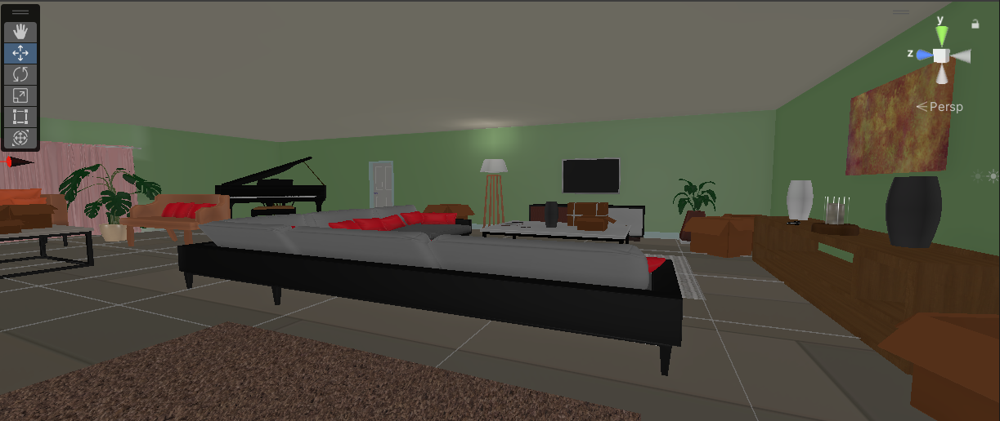 | 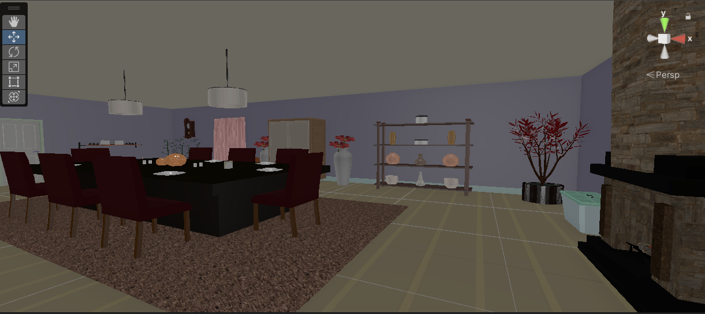 | 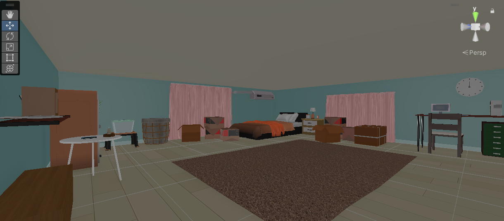 |

The experience begins in the living room, where the player becomes familiar with the environment and the basic interaction mechanics. The second stage takes place in the dining room, where the lighting is reduced and the search tasks become more demanding. The final stage is set in the bedroom, which provides the darkest environment in the experience.

Progression through the rooms depends on the completion of specific objectives. The final objective requires the player to locate a locked chest and open it to discover a letter that concludes the narrative.

The environment was designed to preserve a familiar, non-horror atmosphere while gradually increasing uncertainty through reduced visibility.

---

## Interaction Design

The gameplay is based on active exploration and goal-oriented interaction.

- **Goal-oriented progression:** The player must locate and interact with specific objects before proceeding to the next room.
- **Randomized object placement:** Selected objects may appear in predefined locations, introducing limited variation between playthroughs.
- **Contextual guidance:** In-game hints provide assistance when required without directly revealing the location of an object.
- **Environmental storytelling:** The sequence of rooms, interactive objects, and final letter contribute to the narrative structure.
- **Progressive difficulty:** Reduced visibility and increased environmental uncertainty gradually make exploration more challenging.

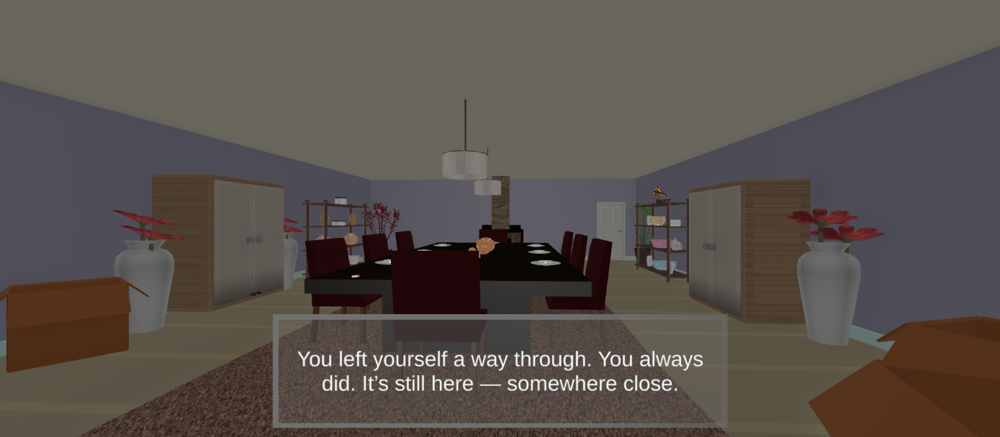

---

## Lighting as a Gameplay Mechanic

Lighting forms part of the gameplay logic rather than serving only a visual purpose.

As the player progresses through the experience, the overall level of illumination is gradually reduced. In `GameManager.cs`, runtime light intensity is adjusted over time using `Mathf.Lerp`, allowing smooth transitions between lighting states.

The project uses a combination of baked base lighting and selected dynamic lighting in order to balance visual quality and performance on standalone VR hardware.

### Dining Room

| Brighter State | Reduced Lighting |
|:---:|:---:|
| 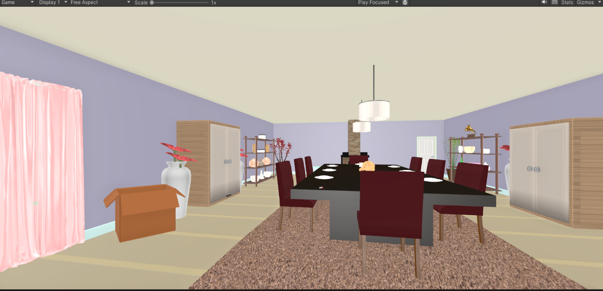 | 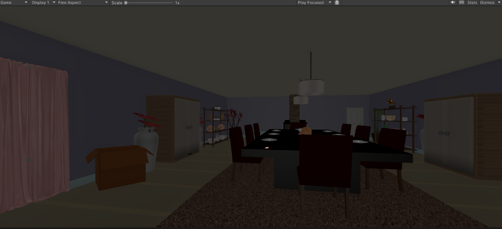 |

### Bedroom

| Brighter State | Reduced Lighting |
|:---:|:---:|
| 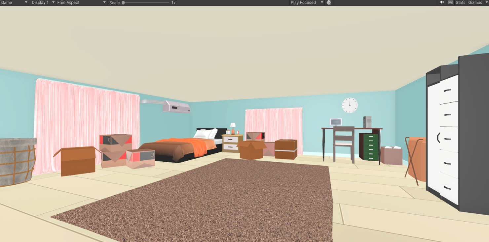 | 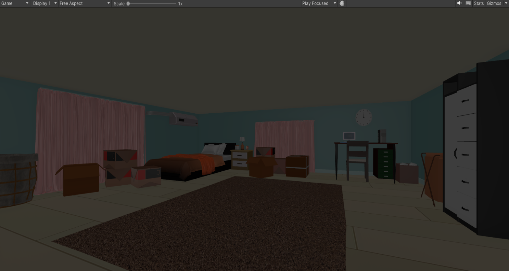 |

A flashlight is also available as a local light source during exploration, allowing the player to search darker areas while maintaining the overall low-light setting.

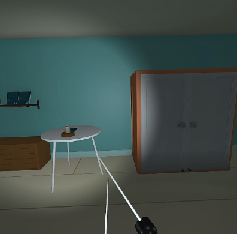

---

## VR Interaction and Comfort

The project includes more than one method of movement in order to accommodate different user preferences.

Continuous movement allows free navigation through the environment, while teleportation provides an alternative method of locomotion. An optional vignette effect can also be enabled to reduce the peripheral field of view during movement.

| Teleportation | Optional Vignette |
|:---:|:---:|
| 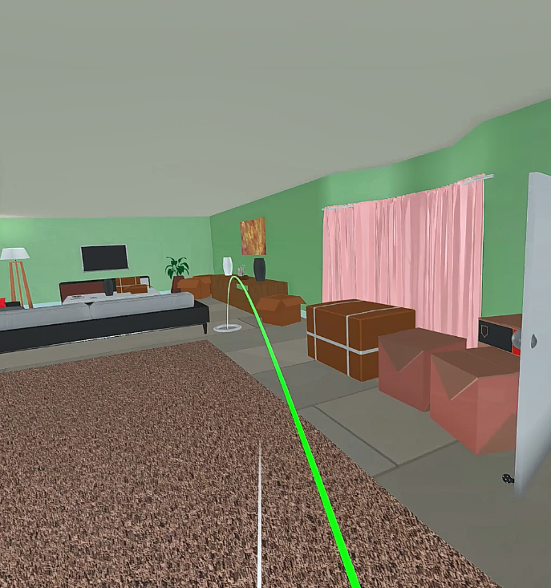 | 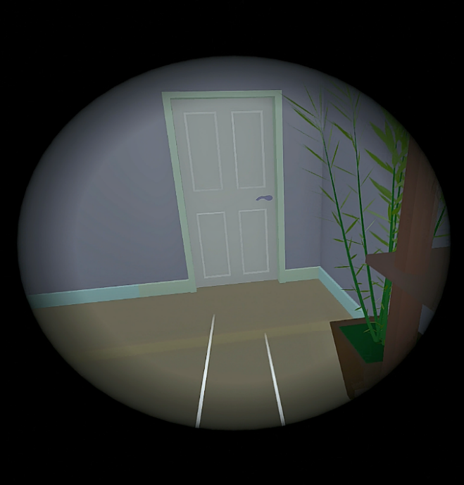 |

These options were included to provide a practical balance between freedom of movement and user comfort in virtual reality.

---

## Narrative Design

The narrative is based on the player's return to an old family home after a long absence.

The progression through the living room, dining room, and bedroom is intended to move gradually from a more public part of the house toward a more personal space. This spatial progression is accompanied by a gradual reduction in lighting.

The narrative reaches its conclusion in the bedroom, where the player discovers a locked chest containing a letter.

The narrative, environmental layout, interaction structure, and lighting system were designed as interconnected elements rather than as separate features.

---

## Selected Implementation

The repository includes the main C# scripts used to implement the project's gameplay logic, interaction, movement, randomized object placement, and lighting progression.

| File | Role |
| --- | --- |
| [`GameManager.cs`](Scripts/Core/GameManager.cs) | Manages room states, objectives, door unlocking, and gradual runtime lighting changes. |
| [`objective.cs`](Scripts/Core/objective.cs) | Communicates completed objectives to the game manager through interaction triggers. |
| [`randomPlace.cs`](Scripts/Core/randomPlace.cs) | Randomizes selected object positions among predefined locations. |
| [`startGame.cs`](Scripts/Core/startGame.cs) | Initiates the first lighting transition at the beginning of the experience. |
| [`PlayerController.cs`](Scripts/Desktop-Prototypes/PlayerController.cs) | Implements player movement and camera control. |
| [`Draggable.cs`](Scripts/Desktop-Prototypes/Draggable.cs) | Implements basic object dragging and interaction logic. |

---

## Gameplay Flow

The experience follows a structured sequence of objectives.

The player begins in the living room, searches for the objects required to continue, proceeds to the dining room, and finally reaches the bedroom. Each stage introduces a new objective together with a lower level of illumination.

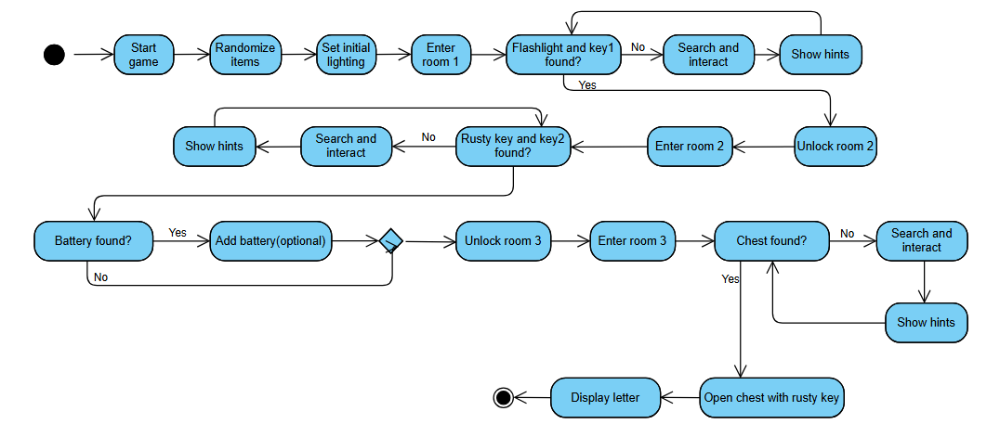

This structure allows environmental conditions, interaction, and narrative progression to develop together throughout the experience.

---

## Technical Stack

- **Unity 2022.3.53f1**
- **C#**
- **Universal Render Pipeline (URP)**
- **Unity Input System**
- **Meta Quest 2**
- **Standalone VR development**

---

## Project Context

The project was developed as a design and implementation prototype exploring VR-based exposure to nyctophobia.

Its main focus was the integration of gradual environmental change, active interaction, narrative progression, and VR-specific design considerations within a single immersive system.

Possible directions for further work include usability evaluation, user studies, behavioral data collection, and adaptive difficulty based on player interaction and performance.
